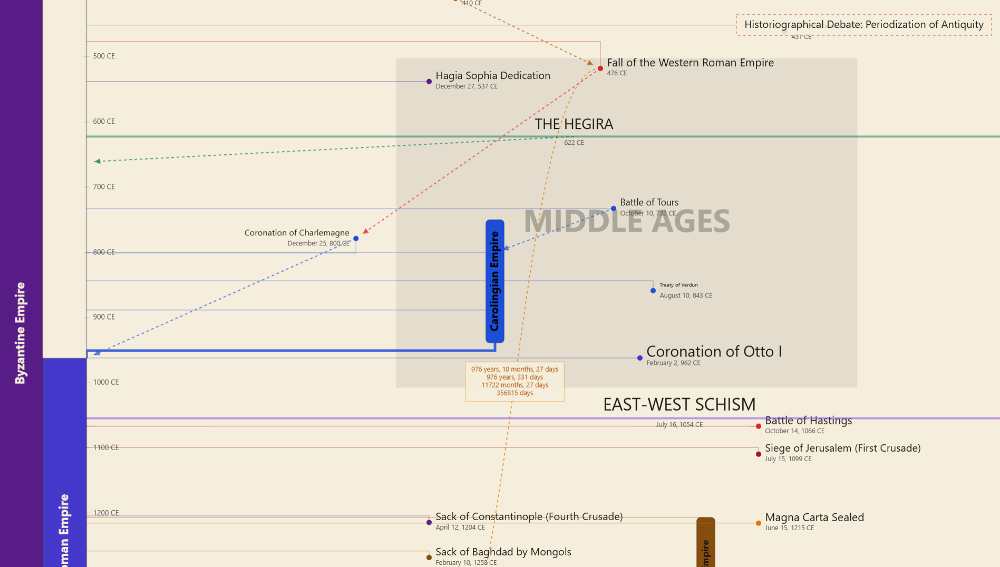
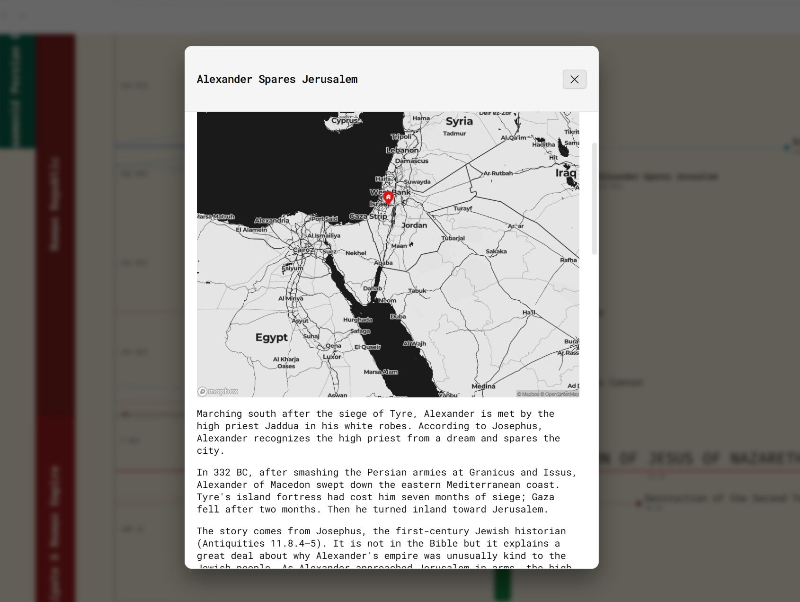

## Support the Engine
Tau is free, but my rent is not 🙄. If this plugin saved you from wrestling with raw YAML for six hours, consider buying me a coffee. 

[](https://www.buymeacoffee.com/easyontheice)



**An infinite, canvas-based vertical timeline and cartographic engine for Obsidian.**

Tau exists mostly because the current landscape of timeline plugins is an inflexible mess. Most tools force non-linear historical events into rigid grids or markdown tables that fall apart the second you introduce overlapping eras or parallel civilizations.

This engine uses a hardware-accelerated HTML5 Canvas to treat your vault like an actual spatial atlas. You can drag events around an infinite vertical coordinate space, pack diverging dynasties into lanes, and link causal events without having to write raw YAML manually. It is also obnoxiously fast—handling 4000-event timelines without lagging, which is likely more history than you actually need to map.

To view a note, double-click on it. To edit its properties, right-click. A basic CSV importer is included, and you can find a template in the datasets folder.

*Special credit to [UsefulCharts](https://usefulcharts.com/) for inspiring the layout architecture of this engine.*



---

## Architectural Overview and Core Concepts

Tau operates on a decoupled data model.

**The Source of Truth**
Your standard Obsidian Markdown notes hold the data. All coordinates, color tokens, and metadata live directly inside the note's YAML frontmatter.

**The World Coordinate System**
Time flows vertically along the Y-axis (yes, it supports astronomical BCE/CE dates), while the X-axis handles your customizable thematic lanes and spatial groupings.

**The Non-Destructive Canvas**
Dragging or linking nodes on the canvas immediately updates your markdown frontmatter via Obsidian's native file manager. Your actual note text is left entirely alone.

---

## Complete YAML Frontmatter Schema

Every note intended for Tau needs `timeline: main` (or whatever you named your timeline instance). Below is a fully loaded example showing every supported property so you know exactly what you are dealing with.

```yaml
---
timeline: main
title: "Eastern Roman Empire"
timeline-kind: span-left
start-date: "395 CE"
end-date: "1453 CE"
color: "#7c2d12"
title-color: "#fef3c7"
date-color: "#fed7aa"
text-direction: vertical
border-style: none
importance: 1.5
coordinates: "41.0082, 28.9784"
horizontal-offset: 0
vertical-offset: 0
span-width: 34
span-height-offset: 0
global-event: false
successor: "Ottoman Empire"
child-of: "Roman Empire"
branch-to:
  - "Empire of Trebizond"
  - "Despotate of Epirus"
influence-to:
  - "Kievan Rus"
measure-to: "Fall of Constantinople"
time-travel: ""
image: "byzantine-double-eagle.png"
image-width: 120
---

# Historical Context and Markdown Body
Content written here is completely preserved. Double-clicking this node on the timeline opens the native Markdown Inspector view without editing your metadata.

```

### Property Dictionary

| Key | Type | Default | Description |
| --- | --- | --- | --- |
| `timeline` | String | `main` | Associates the file with a specific timeline instance. |
| `title` | String | *Filename* | The display title rendered on the canvas. |
| `timeline-kind` | String | `event` | Geometry mode `event`, `span`, `span-left`, `era`, `region`, or `note`. |
| `start-date` | String | *Required* | Formatted date (e.g. `1453 CE`, `27 BCE`, `1789-07-14`). |
| `end-date` | String | *Optional* | Terminus date (required for spans, eras, and regions). |
| `color` | String (Hex) | `#1c1917` | Fill color for dots, ribbons, backgrounds, and links. |
| `title-color` | String (Hex) | `#000000` | Text color for node labels. |
| `date-color` | String (Hex) | *Dynamic* | Explicit override for date labels (falls back to theme default). |
| `text-direction` | String | *Auto* | Forces `vertical` or `horizontal` text orientation. |
| `border-style` | String | `none` | For notes `solid`, `dashed`, or `none`. |
| `importance` | Float | `0` | Scales font and indicator sizes. Values `< 0` flag the item as a minor node. |
| `coordinates` | String | `""` | Geographic `latitude, longitude` coordinates for spatial mapping. |
| `horizontal-offset` | Integer | `0` | X-axis pixel displacement relative to the spine. |
| `vertical-offset` | Integer | `0` | Y-axis pixel displacement relative to the true date coordinate. |
| `span-width` | Integer | *Dynamic* | Manual width override for ribbons and background columns. With span auto-fit on, acts as the minimum ribbon width. |
| `span-height-offset` | Integer | `0` | Extends ribbon bounds independently of dates. With auto-fit on, ribbons grow to fit their label. |
| `global-event` | Boolean | `false` | Renders a full-bleed horizontal dividing line across the entire viewport. |
| `successor` | String/List | `""` | Fuses the node into a dynastic lane. List several to split the lane equally left to right. |
| `child-of` | String | `""` | Targets a parent node for a cubic Bezier S-curve link. |
| `branch-to` | List | `[]` | Targets nodes for orthogonal subway-style divergence. |
| `influence-to` | List | `[]` | Targets nodes for dashed directional influence vectors. |
| `measure-to` | String | `""` | Draws an interactive measurement line calculating temporal distance. |
| `image` | String | `""` | Obsidian link, embed, or vault path to render inline artwork. Replaces the node entirely on events and notes. |
| `image-width` | Integer | `100` | Rendered pixel width of the inline image artifact. |

---

## Supported Node Geometries

Tau adapts its rendering pipelines based on the semantic role of the note.

**Point Events** (`event`)
Discrete historical moments. Rendered as a circular milestone connected to the left time spine. You can promote it to a global event to draw a dividing line across the entire screen.

**Spans** (`span`)
Continuous intervals. These show up as floating vertical ribbons with heights reflecting their actual duration. Includes automatic edge-clamping for labels.

**Left Spans** (`span-left`)
The Legend Zone. This occupies a dedicated column cluster along the left edge, ideal for macro-civilizations and dynasties. Packed with collision-avoidance logic.

**Eras** (`era`)
Broad contextual backdrops. Painted as ultra-low-opacity vertical bands that span the entire viewport behind your active events.

**Regions** (`region`)
Spatial boundary boxes that bracket both time and horizontal space to group localized sub-histories together.

**Notes** (`note`)
Floating annotations for citations or context blocks, complete with configurable borders.

---

## Core Engine Features

### Absolute Spatial Freedom and Auto-Scatter

Unlike traditional tools that collapse overlapping dates into an unreadable mess, you actually control where things go here.

Click and drag any node. When you let go, Tau writes the exact pixel offset directly into your frontmatter. If your timeline is a disaster, right-click and run Auto-scatter all events. The engine calculates chronological spacing and disperses everything across 50 lanes, fixing your visual pileups in a single pass.

### Advanced Lineage and Linking

This is essentially a relational network graph mapped onto chronological space.

* **Child-Of** generates smooth S-curves from a parent down to a child.
* **Branch-To** creates right-angle subway tracks for divergent successors.
* **Influence-To** draws dashed vector arrows to show cultural or military impact.
* **Measure-To** draws an interactive ruler between two nodes to calculate exact temporal distances in years, months, and days.

### Dynastic Succession and Assimilation

When plotting successive dynasties in the left legend, overlaps are inevitable. If you specify a successor, Tau bypasses standard collision rules and locks the successor into the exact same column as its predecessor. If they overlap in time, the engine generates a hatched integration zone blending both colors, because transitions of power are rarely clean.

### Dual-Modal Interface

Viewing and editing are strictly separated so you do not ruin your data by accident.

Double-clicking a node opens the Inspector Panel, which simply uses Obsidian's Markdown engine to display your text and images. Right-clicking and selecting to edit properties opens the Master Editor HUD, mapping all attributes to actual inputs and color pickers. Saving updates the frontmatter and renames the file if necessary.

### Power User Tools

Assign an importance integer to your nodes. Setting it to -1 flags the item as low-priority, allowing you to hide minor nodes and clear out the clutter. You can also hold Shift to lasso multiple nodes to move or delete entire eras at once.

For long spans that stretch beyond the screen, the title text pins itself to the viewport boundary so you do not forget what you are looking at while scrolling. You can also perfectly align a node's horizontal position with another via the context menu.

---

## Context Menu Cheat Sheet

Right-click the canvas or a node to access the command HUD.

| Menu Item | Target | Description |
| --- | --- | --- |
| **Edit node properties** | Node | Opens the Master Editor HUD for full YAML configuration. |
| **Open Markdown file** | Node | Opens the source `.md` file in an Obsidian workspace tab. |
| **Assign image / Change image** | Node | Pick any image in your vault to render on the timeline. |
| **Set image width** | Node | Sets `image-width` in pixels. |
| **Remove image** | Node | Clears the image data. |
| **Delete node(s)** | Node | Moves the selected node or group to the trash. |
| **Align horizontally to...** | Node | Raycasts to a clicked target and snaps the current node to its X-coordinate. |
| **Succeeded by...** | Node | Raycasts to add a dynastic successor for lane-sharing. |
| **Child of...** | Node | Raycasts to create a Bezier S-curve from a parent node. |
| **Branch to...** | Node | Raycasts to generate an orthogonal subway divergence line. |
| **Influence to...** | Node | Raycasts to establish a dashed directional vector arrow. |
| **Measure to...** | Node | Raycasts to calculate and display real-time chronological distances. |
| **New node** | Canvas | Generates a blank note template and opens the editor HUD. |
| **Set left strip width** | Canvas | Adjusts the pixel width of the left dynastic legend. |
| **Auto-scatter all events** | Canvas | Automatically disperses overlapping events into readable lanes. |
| **Show/hide minor nodes** | Canvas | Hides or reveals all nodes with negative importance. |
| **Show/hide display toggles** | Canvas | Independent display switches for gridlines, spines, and dates. |
| **Enable/disable span auto-fit** | Canvas | Toggles whether ribbons automatically grow to fit their text. |

---

## Controls and Navigation

* **Pan Timeline** Left-click and drag on an empty section of the canvas.
* **Temporal Zoom** Hold Ctrl (or Cmd on macOS) and scroll the mouse wheel to scale from days to thousands of years.
* **Horizontal Pan** Hold Shift and scroll the mouse wheel to traverse lanes.
* **Move Nodes** Click and drag a selected node or lassoed group.
* **Multi-Select Lasso** Hold Shift, then click and drag a bounding box.
* **Open Reader** Double-click any node.
* **Context Actions** Right-click the canvas or a node.

---

## Installation

### Via Obsidian Community Plugins (Recommended)

1. Open Obsidian Settings and go to Community Plugins.
2. Ensure they are enabled, then click Browse.
3. Search for Tau.
4. Click Install, then Enable.

### Manual Installation

1. Download the latest release assets from GitHub.
2. Inside your Obsidian vault, navigate to `.obsidian/plugins/` and create a `tau` directory.
3. Paste the downloaded files in there.
4. Reload Obsidian and enable the plugin.

---

## Privacy and Data Access

Tau operates entirely inside your vault and makes zero network requests. It reads your frontmatter to build the timeline, lists image files only when you ask it to, and only writes to the frontmatter you explicitly change. Two basic display preferences are stored locally. That is it.

---

## License

MIT License. Built for historical researchers, world-builders, and anyone else meticulously archiving time. 🙄
